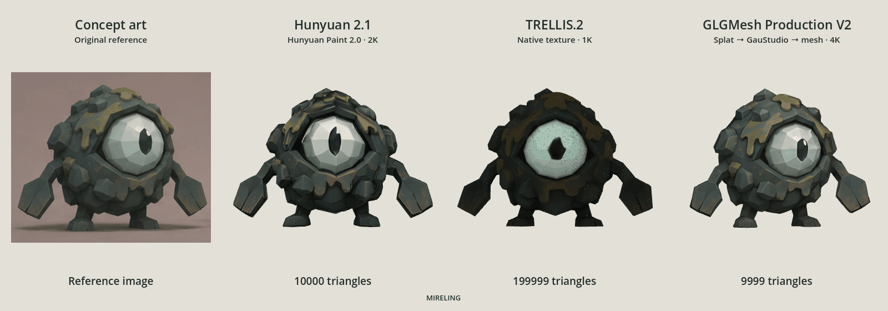

# GLGMesh

**Generate textured, low-poly 3D models from a reference image.** GLGMesh combines local AI shape generation, mesh reconstruction, triangle reduction and texturing in a browser workbench and command-line tool. Set a triangle budget, compare the result, and export a GLB for further work in a game engine or 3D editor.

From left to right, the comparison above shows the **original Mireling concept art**, then **Hunyuan 2.1 + Hunyuan Paint 2.0 (10,000 triangles)**, **TRELLIS.2 (199,999 triangles)**, and **GLGMesh Production V2 (9,999 triangles)**. These use different geometry budgets and texture methods; they are examples, not a controlled benchmark. [Still image and rendering details](docs/SHOWCASE.md).

**Platform:** Designed to run on **Apple Silicon Macs with at least 16 GB of unified memory**, using MLX, PyTorch MPS and Metal. This release does not implement Windows, Linux, Intel Mac or CUDA execution. Inference runs locally after setup; no hosted inference service or API key is required. Some model downloads require a Hugging Face account and access approval.

## What you can do

- Turn a concept image into a mesh with an explicit triangle budget.
- Choose a fast prototype, a more detailed mesh, or a splat-based reconstruction pipeline.
- Generate reference-guided RGB textures or keep geometry-only output where supported.
- Rotate the mesh automatically, drag it, set an exact viewing angle, and toggle its texture.
- Download a textured or neutral GLB without altering its geometry.
- Inspect the source Gaussian splat for either Production pipeline.
- Resample Production results at a new triangle budget from saved dense geometry, without repeating AI shape generation.
- Cancel and resume jobs with stage checkpoints, progress logs and geometry QA reports.

## Quick start

Install **Python 3.12**, **Blender 5.2+**, **Git** and the **Xcode Command Line Tools** first. See [requirements and installation](docs/INSTALLATION.md) for model access, storage, build tools and environment details.

From the repository directory:

```sh
./glgmesh.sh doctor
./glgmesh.sh setup fast
./glgmesh.sh ui
```

Open **http://127.0.0.1:8766**, choose a source image, select a pipeline, set **Output triangles**, and generate. Alternatively, double-click **Launch GLGMesh.command**. Keep the server terminal open while using the UI.

Setup downloads pinned dependencies, source repositories and model weights into `runtime/`. Install only the pipelines you need. A transparent PNG with one fully visible subject works best; JPG and WebP are also supported, with local background removal.

## Choose a pipeline

| Pipeline | Geometry workflow | Default texture | Default budget |
|---|---|---|---:|
| **Prototype** · `fast` | Hunyuan Mini → Blender reduction | Hunyuan Paint 2.0 · 2K RGB | 10,000 |
| **Medium quality** · `medium` | Hunyuan 2.1 → Blender reduction | MV-Adapter SD2.1 · 2K RGB | 10,000 |
| **High quality** · `high` | TRELLIS.2 → reduction and UV unwrap | TRELLIS.2 native · 1K | 200,000 |
| **Production V1** · `production` | IDOL splat → surface reconstruction → ~10k intermediate → Hi3D → target reduction | MV-Adapter SD2.1 · 2K RGB | 10,000 |
| **Production V2** · `production-textured` | IDOL splat → GauStudio adaptation → target reduction | Splat appearance projection and rebake · 4K | 10,000 |

Prototype is the quickest starting point. Medium uses a larger Hunyuan shape model. High quality retains more geometry by default. Production V1 uses Hi3D to refine the reconstructed shape; Production V2 transfers the splat’s appearance directly to a reduced mesh.

Budgets are triangle ceilings, not guaranteed exact counts. Cleanup may produce slightly fewer triangles. Runtime varies with the image, settings, available memory and processor; the UI’s initial estimates are approximate and exclude setup. Production sampling is substantially slower than the direct mesh pipelines.

Choose **Texture → None** for geometry-only Prototype, Medium or Production V1. High quality and Production V2 include their native appearance stages. [Pipeline details and limitations](docs/PIPELINES.md).

## Command-line examples

```sh
# Install and generate with the selected pipeline.
./glgmesh.sh setup medium
./glgmesh.sh run concept.png --mode medium --triangles 10000

# Geometry-only prototype.
./glgmesh.sh run concept.png --mode fast --texture none --triangles 5000

# Splat-based textured reconstruction.
./glgmesh.sh setup production-textured
./glgmesh.sh run concept.png --mode production-textured --triangles 10000

# Add the default texture method to an existing untextured result.
./glgmesh.sh texture JOB_ID

# Resample either Production pipeline from its saved dense source.
./glgmesh.sh resample JOB_ID --triangles 20000

# Continue a cancelled or failed job; emit JSON progress if desired.
./glgmesh.sh resume JOB_ID --json
```

Use `./glgmesh.sh --help` or a command’s `--help` for options. `--seed` controls generation; `--refiner-seed` controls Hi3D. Production modes accept `--idol-steps 50` through `400`, defaulting to `50`. More steps cost more time and do not guarantee a better result.

## Preview, export and resampling

The viewer has automatic rotation, a manual angle slider, drag controls, texture switching and front/back/three-quarter/wireframe views. **Download model → Without texture** creates a neutral GLB while preserving triangle positions, UVs, normals and transforms. The preview and download settings are independent.

Production resampling accepts higher or lower targets, from **100 to 2,000,000 triangles**. It always starts from retained dense geometry, not the last reduced mesh. V1 uses Hi3D’s native postprocessing and regenerates its MV texture when enabled. V2 reduces and rebakes the retained GauStudio mesh. A target above the dense source’s triangle count cannot add new geometric detail. Resampling does not rerun IDOL, Hi3D inference or GauStudio reconstruction.

## Outputs and local data

Each job is saved in `runs/JOB_ID/` with its input, settings, checkpoints, logs, `model.glb`, `result.json`, `qa.json` and review images. Texturing jobs also retain `basecolor.png` and an editable `model.blend` where supported. Production intermediates enable later resampling and source-splat preview.

Keep `runtime/` for future generation and `runs/` for your assets and resumable checkpoints. Both are excluded from version control. Initial setup uses the network; inference workers run with offline model loading and blocked outbound socket connections. The UI binds to the local loopback interface.

## Quality limits

GLGMesh produces **starting assets**, not automatically finished game art. Inspect silhouettes, thin parts, disconnected geometry, UV seams and texture consistency. Rigging, deformation topology, collisions and artistic cleanup remain separate work. A completed generation can still have QA findings, which are shown in the UI and reports.

Hunyuan Paint and MV-Adapter generate RGB color, with constant roughness and metallic values rather than full PBR maps. Production V2 uses an **unlit baked appearance**, which includes source shading. Hidden surfaces are inferred. Atlas resolution does not equal generated image detail. Source scale and orientation may need adjustment before use in an engine.

## Development

```sh
python3.12 -m unittest discover -s tests -v
# Optional: refresh the bundled browser libraries.
npm ci --prefix frontend
npm run vendor --prefix frontend
```

Node/npm are only needed to rebuild the bundled viewer; they are not runtime requirements. Model inference is not run by the unit suite. See [architecture](docs/DESIGN.md) and [validation scope](docs/VALIDATION.md).

## License and credits

GLGMesh’s original code is available under the [GLGMesh Attribution and Commercial Software License 1.0](LICENSE), a custom source-available license. Commercial software integrations, paid applications, APIs and SaaS using GLGMesh code require a separate written license from **Edgechasers**: [glgmesh@edgechasers.com](mailto:glgmesh@edgechasers.com).

You may create and use assets for **any purpose, including commercial projects and asset sales**, without a separate GLGMesh commercial license, provided you credit **“powered by GLGMesh”** and comply with applicable third-party terms. Using GLGMesh as an asset-production tool for yourself or clients is included in this permission. All other uses of GLGMesh code also require explicit attribution. Credits, an About page or accompanying documentation can satisfy the license’s placement requirements; an artwork watermark is not required. See [licensing examples](docs/LICENSING.md).

Included third-party code, downloaded models and dependencies retain their individual licenses and access conditions, which you must comply with. GLGMesh’s asset permission does not override upstream restrictions on weights or outputs. See [third-party components](THIRD_PARTY.md). Earlier MIT releases retain the rights granted under MIT.

The showcase media illustrates the tool; it is not a downloadable model pack. Its artwork is separate from the code license; see [showcase details](docs/SHOWCASE.md).
