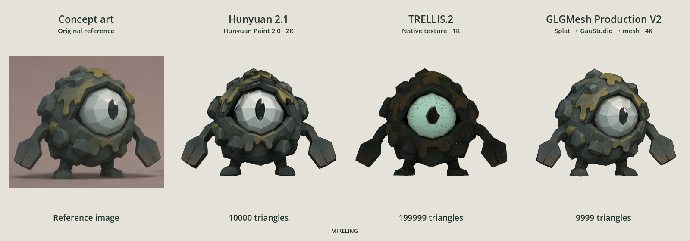

# Mireling comparison



The README animation starts with the original Mireling concept art, followed by three existing textured models derived from that reference:

| Model | Triangles | Appearance |
|---|---:|---|
| Hunyuan 2.1 | 10,000 | Hunyuan Paint 2.0, six native generated views, 2K RGB bake |
| TRELLIS.2 | 199,999 | Native 1K texture |
| GLGMesh Production V2 | 9,999 | IDOL splat → GauStudio adaptation → reduced mesh with 4K appearance rebake |

The animation is 120 frames at 1600 × 560, with an eight-second seamless rotation loop. The concept image stays fixed in the first column while the three models rotate in sync on a light background. Front orientation is aligned per source, and each model is scaled to equal display height. The renderer shows embedded base color without extra directional lighting so baked shading remains visible. No geometry or texture enhancement is applied for the comparison.

These are different pipeline outputs at different budgets. TRELLIS retains substantially more triangles. The comparison illustrates appearance and silhouette, not equal-cost or equal-budget performance. The Hunyuan example uses Medium mode’s supported optional Hunyuan Paint texture (`--texture rgb`), rather than its default MV-Adapter texture; this does not claim all three examples came from one fresh release run.

The [provenance manifest](media/mireling-comparison.json) records source-file hashes and render settings without local filesystem paths. The source GLBs, standalone original concept file and raw render frames are not distributed; the reference is embedded in the showcase media. The code’s MIT license does not grant a separate license to the depicted character artwork.

## Regenerate a turntable

Optional developer dependencies: Godot 4 with its compatibility renderer, Python and Pillow. This is separate from GLGMesh inference.

Create a JSON object with `concept: {"path": "/path/to/reference.png"}` and a `models` array of exactly three entries, each containing `path` (an absolute path to a GLB), `label`, `detail`, `triangles` and optional `yaw` (radians). Then run:

```sh
godot --path tools/showcase --script render.gd -- /path/to/manifest.json /path/to/frames
python3 tools/showcase/encode.py /path/to/frames docs/media/mireling-comparison.gif
```

The renderer verifies imported triangle counts and textured materials. Keep manifests containing private paths and raw frames outside published source directories. The encoder checks frame count, loop duration and dimensions.
